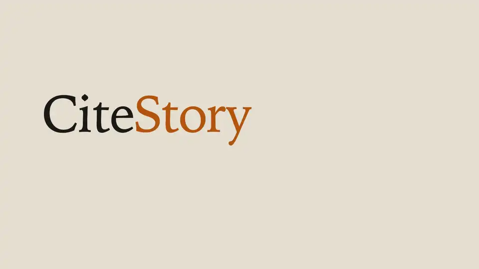
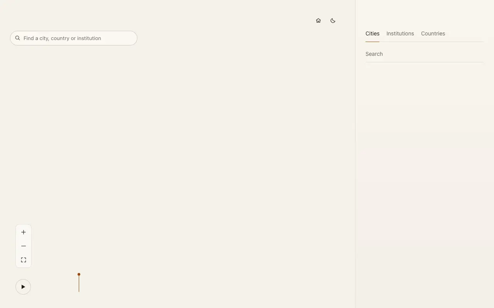
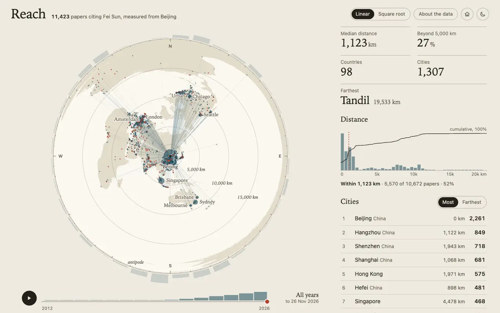
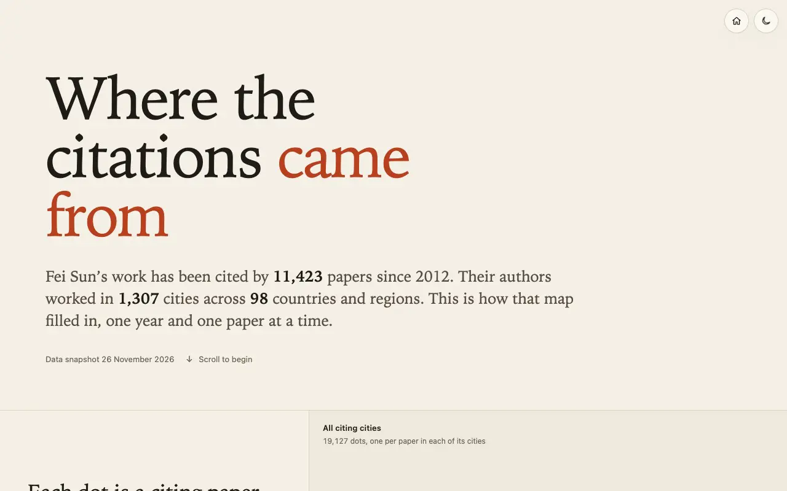
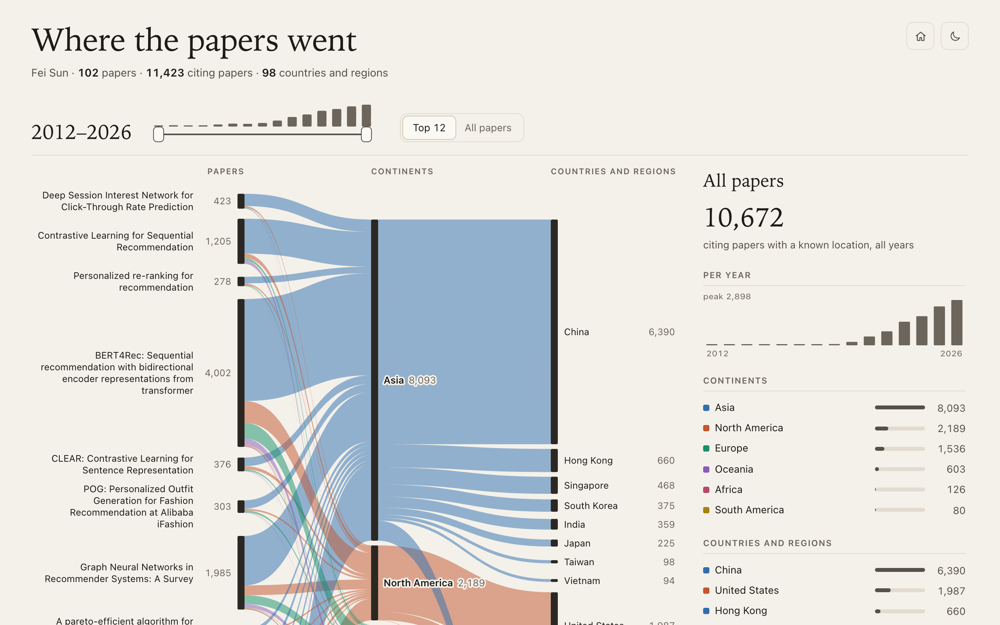
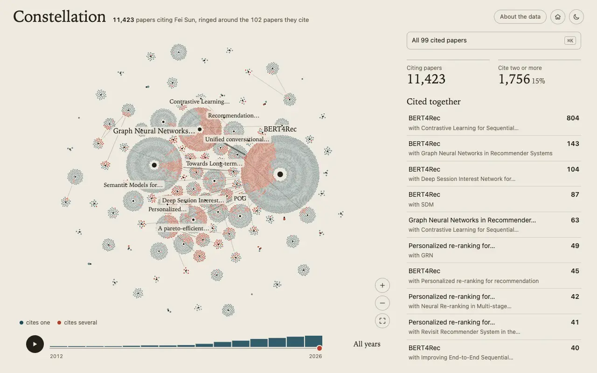
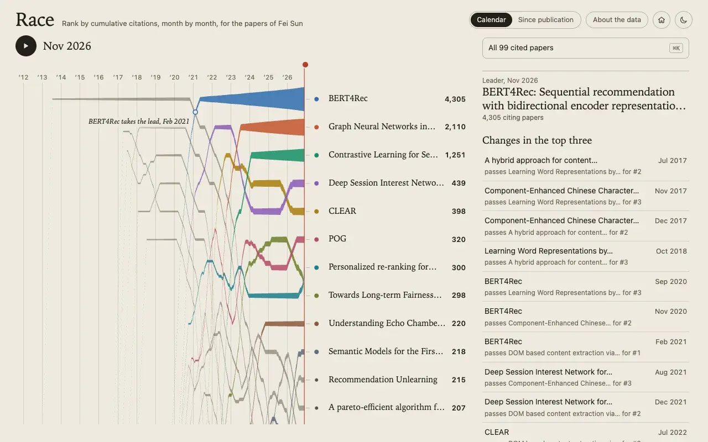
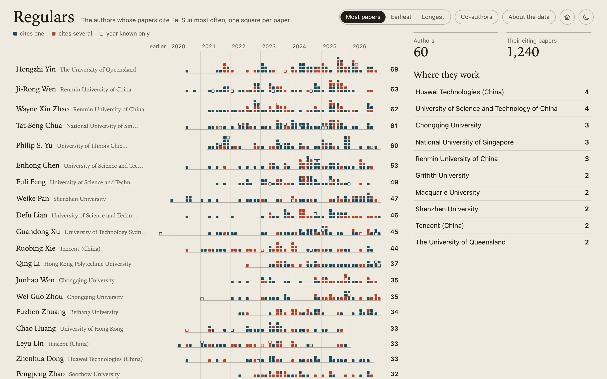
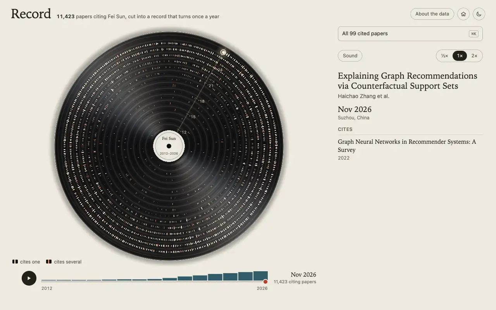

<h1 align="center">
  
  
</h1>

<p align="center">The story behind your citations: who reads your papers, where, and since when.</p>

<p align="center">
  
  
  
  
</p>

<p align="center"><a href="#atlas-where-in-the-world">Atlas</a> · <a href="#reach-how-far">Reach</a> · <a href="#story-how-it-spread">Story</a> · <a href="#flow-from-paper-to-place">Flow</a> · <a href="#constellation-papers-and-their-neighbours">Constellation</a> · <a href="#race-who-led-when">Race</a> · <a href="#regulars-who-keeps-coming-back">Regulars</a> · <a href="#record-listen-to-it">Record</a> · <a href="#year-one-year-looked-back-on">Year</a></p>

<p align="center"><b>English</b> | <a href="README.zh-CN.md">简体中文</a></p>



Give it a Google Scholar profile; it finds every paper that
cites that person in [OpenAlex](https://openalex.org), places each one at the cities of its authors'
institutions, and builds nine interactive pages from the result. Run one command again next month and the
pages are up to date.

- **Nine views, one dataset.** Two maps, a long read, a flow diagram, a star chart, a race, a table of regular
  readers, a record you can play and a look back at the year.
- **One input.** A Scholar URL. Optional fields cover the cases the automatic guesses get wrong.
- **Static output.** Plain HTML, CSS and JavaScript files with no build step and no framework. They open from
  disk or from any static host. Eight of the nine pages work offline.
- **Standard library only.** The pipeline is Python 3.9+ with no packages to install.

The images show my own profile (11,423 citing papers from 1,307 cities, snapshot of 26 November 2026), in the light theme; every page also has a dark one. The animations are real recordings of the pages, sped up.

## Contents

- [The views](#the-views)
- [Quick start](#quick-start)
- [profile.json](#profilejson)
- [Keeping it current](#keeping-it-current)
- [Putting it on a website](#putting-it-on-a-website)
- [Why OpenAlex, not Google Scholar](#why-openalex-not-google-scholar)
- [How the numbers are made](#how-the-numbers-are-made)
- [Repository layout](#repository-layout)
- [Credits and inspirations](#credits-and-inspirations)
- [Why I made this](#why-i-made-this)
- [Built with AI](#built-with-ai)
- [License](#license)

## The views

All of them start from the same question: a citation count is one number, but each citation is a paper
somebody wrote, somewhere, at some moment. What does the count look like when those papers are put back on
the map and back in time?

Why each view takes the form it does, what was tried and dropped, and how Record's sound works are in
[DESIGN.md](DESIGN.md).

A paper chosen in Atlas, Reach, Story, Flow, Constellation, Race or Record is kept in the address (`?paper=`), and
the "Open in" links under it open the same paper in the other views.

### Atlas: where in the world



A globe that unfolds into a live street-level map. Each city that has produced a citing paper is a point of
light, and an arc runs to it from the owner's home institution along the great circle. Press play and the
citations arrive in order, from the first one to the snapshot date. You can pick a single paper, search any
city, country or institution, and switch between globe and flat map.

Brightness and arc strength follow the square root of a city's count, so the few very large cities do not
drown out the long tail of places with one or two papers. The arcs show a connection, not a route.

This is the only page that needs the network: it loads MapLibre GL JS and OpenFreeMap tiles.

### Reach: how far



The world redrawn around one point. Reach uses an azimuthal equidistant projection centred on the owner's
city: every city sits at its true distance and true bearing, and the rim of the disc is the antipode, the
point exactly opposite on the globe. Rings mark 2,000, 5,000, 10,000 and 15,000 km; a switch
spreads out the crowded centre with a square-root scale. The histogram on the right
answers "how far did the ideas travel?": the median distance, the share beyond 5,000 km, and the farthest
city. A paper picker shows the reach of one paper.

### Story: how it spread



A scrolling long read, one WebGL dot per citing paper. The dots start on the map, clustered at their cities,
then leave it to become bars of citations per year, stacks by continent, and rows by institution, before
returning to the map.

The text is computed from the data, not written for one person:
- when the first citations came and from where;
- the year the record took off (the year before the sharpest rise);
- which papers travelled farthest;
- how large home is in the picture;
- which countries appear exactly once.

Chapters the data cannot support are left out, for example "the slow years" for a record that started fast.

### Flow: from paper to place



No map at all. Ribbons run from each paper to the continents and then the countries that cite it. A
ribbon's width counts the citing papers that link that paper to that country; a paper with authors in two
countries adds to both. It answers questions a map makes hard: which paper is mostly read in
one country, and which one spread widely.

### Constellation: papers and their neighbours



Every cited paper is a star. Its citing papers are dots in rings around it, one ring per year with the
oldest inside. The dots are packed by the golden angle, so each dot takes the same area and a wide band means
a busy year.

A citing paper that cites several of the owner's papers is drawn in the accent colour, on the side of the
ring that faces the others. Stars that are often cited together sit close to each other, placed by a
deterministic force layout, and lines join the strongest such pairs.

### Race: who led when



Rank by cumulative citations, drawn as ribbons through time. A lane is a rank, a ribbon's width grows with its count,
and where two ribbons cross, one paper overtook the other. This is the bar chart race without the bars: the
whole history stays visible instead of flashing past. An overtake is listed only if the new order holds for
six months.

A second clock, "Since publication", starts every paper at its own publication date, so a 2012 paper and a
2022 paper are compared at the same age.

### Regulars: who keeps coming back



The authors who cite the work most often: one row each, one square per citing paper, stacked by quarter.
Squares in the accent colour cite several of the owner's papers. Hollow squares are papers whose date is
known only to the year. Co-authors are hidden by default and can be shown with one switch.

This page lists other people's names. They come from public bibliographic records, but keep that in mind
before you publish it.

### Record: listen to it



The citation history cut into a record that turns once a year, with every citing paper a cut in the groove.
Play it, drag it round by hand, or drag the needle across the years. With sound on, each cited paper has a
fixed note on a D Lydian scale, chosen so that the most-cited papers form a chord. A cut plays the notes of
the papers it cites, and cuts that pass together sound together: a busy year sounds fuller, not faster.

### Year: the year, looked back on

The latest calendar year, told in a few screens with the same dots from start to end: one dot for every paper that
cited the work that year. The dots spell the year, turn into a ring of the year's days, stack over the years the papers they cite were written in,
split into new and returning readers, group by the phrases in their titles, and fly to the map, where fog
still covers every place no reader has appeared in. Along the way the page names what was new: the papers published that year and the conferences
they went to, each one's first reader, the papers that passed a round number, the cities and countries
reached for the first time (one stamp each), the farthest place of the year, and the distance to all the
year's readers added up. Scrolling drives the motion; Play runs it like a short film. At the end the dots
fly into a card: the map of the year with the conferences where the owner's papers were presented, the
year's first citation and its farthest place; five figures (new papers, citations, readers, cities,
countries and regions); and a stamp for every country reached for the first time. The card saves as a
1080 × 1350 picture, or as a vector PDF through the browser's print dialog. Text is in English or Chinese.

Three things are there to be felt more than read. On the ring of days, **Listen** plays the year in about 25
seconds, with the notes of Record. Near the end, the names of everyone who wrote a citing paper that year roll
by in the order they arrived; anyone can find their own name there and save a card of it. And the card carries the address of the page when it is on the web, or
else where to make one.

The page shows one year: the snapshot's, or in January and February the year just ended.

New papers are the papers on the Scholar profile, in the year written in their venue ("SIGIR 2026"), so a
paper OpenAlex has not matched still counts. Conference cities are not in OpenAlex. They come from a small
table, `code/venues.json`; a paper whose conference is not listed there is counted but left off the route.
The stamps of new countries show a small line drawing of the city the paper arrived in, from
`code/landmarks.json`; a city that is not listed there gets the outline of its country, and drawings for more
cities are welcome. Every scene has a button that saves it as a picture.

There is also an index page that links all nine and states the totals.

## Quick start

You need:
- Python 3.9 or newer, standard library only;
- a network connection, for OpenAlex and Google Scholar;
- any modern browser to view the result.

```sh
git clone https://github.com/FeiSun/CiteStory.git citestory
cd citestory
mkdir -p profiles/me
cat > profiles/me/profile.json <<'EOF'
{ "scholar_url": "https://scholar.google.com/citations?user=XXXXXXXXXXXX" }
EOF
python3 code/citestory.py update profiles/me
open profiles/me/site/index.html        # macOS; elsewhere, open the file in a browser
```

The first run matches the profile's papers to OpenAlex: once a few are found by title, it lists every work under
the owner's OpenAlex author ids (one request per 200 works) and searches by title only the papers missing there.
For a profile of 108 papers that took 59 requests instead of 108. It then pages through the citing works
(about 60 requests for 11,000 citing papers), then looks up the institutions. Expect a few minutes.

**Get a free OpenAlex API key first.** OpenAlex gives each user a daily budget that resets at midnight UTC:
$0.10 without a key, shared by everyone on your IP address, and $1 with a free key. A title search costs $0.001
and a page of results $0.0001. The first run for a profile of 100 papers and 11,000 citing papers costs about
about $0.07: fewer than 60 searches and lists, then about 100 pages of citing works and institutions. Without a
key, the daily budget runs out after about 95 searches; the run stops and resumes the next day. A monthly update costs about $0.02,
because only new titles are searched. With a free key, both fit well within the daily budget, so nothing is paid.

Create an account at [openalex.org/signup](https://openalex.org/signup) and copy the key from
[Settings → API key](https://openalex.org/settings/api-key). The tool reads it from the `OPENALEX_API_KEY`
environment variable, or else from a `.env` file in the repository folder (the folder that holds `code/`;
it is git-ignored). The key is sent as a header and never written to disk or to the logs.

```sh
echo 'OPENALEX_API_KEY=...' > .env      # or: export OPENALEX_API_KEY=...
```

Google Scholar has no API. The tool reads the public profile page the way a browser does: one request per
100 papers, with a pause between them. If Google answers with a CAPTCHA, the run stops and says so. In that
case, open the profile in your browser, click "Show more" until it is greyed out, save the page, and point
`scholar_html` at the file. Keep that file private: a page saved while you are signed in contains your
account email.

The example profile in `profiles/example/` shows every field.

## profile.json

```json
{
  "scholar_url": "https://scholar.google.com/citations?user=XXXXXXXXXXXX",
  "scholar_html": "scholar.html",
  "aliases": ["张三", "S. Zhang"],
  "home": "I4210090176",
  "deploy_to": "~/sites/my-al-folio/assets/citations"
}
```

Only `scholar_url` (or `scholar_html`) is required.

| field | use |
|---|---|
| `scholar_url` | the public Google Scholar profile |
| `scholar_html` | a saved copy of the profile page, used when Google refuses the URL |
| `name` | the owner's name, if it differs from the one on the Scholar profile |
| `aliases` | other spellings that appear in bylines: a name in another script, a former name, "J. Smith" |
| `openalex_author_ids` | OpenAlex author ids that are the owner, for bylines too unusual to match (`A5101467161` or the author's OpenAlex URL) |
| `home` | the OpenAlex id of the owner's institution, when the automatic guess is wrong or missing ([search it here](https://openalex.org)) |
| `deploy_to` | a folder the built pages are copied into after every build |

## Keeping it current

```sh
python3 code/citestory.py update profiles/me     # new snapshot, then rebuild
python3 code/citestory.py build  profiles/me     # rebuild only, e.g. after editing a template
```

Each `update` re-reads the Scholar list, matches only the titles it has not seen before, downloads every
citing paper again, and rebuilds. The new snapshot replaces the old one only when it is complete. If a run
stops (rate limit, network, request budget), the site is rebuilt from the previous snapshot, the command
exits with status 2, and the next run resumes where it stopped. `--restart` throws away an unfinished
refresh.

The snapshot lives in `profiles/me/data/`: `targets.json` (your papers and their matches), `citing.json`,
`institutions.json` and `manifest.json`. `name`, `aliases`, `openalex_author_ids` and `home` are applied by
`update`, not by `build`. Unmatched titles are searched again on every `update`, so a new alias takes effect
at once; titles matched before keep their matches. To drop a wrong match, delete `data/targets.json` and run
`update`, which then searches every title again.

To refresh monthly, a crontab line is enough:

```cron
0 6 1 * *  cd /path/to/citestory && python3 code/citestory.py update profiles/me >> update.log 2>&1
```

## Putting it on a website

`profiles/<name>/site/` holds everything the pages need and nothing else: ten HTML files (nine views and the index)
and five data files. Copy the folder to any static host, or set `deploy_to` to have it copied for you.

**The look follows [al-folio](https://github.com/alshedivat/al-folio)**, the Jekyll theme I use for my
homepage:
- serif headings and quiet colours;
- a light/dark theme stored under the same `localStorage` key (`theme`), so switching the site's theme also
  switches the pages;
- an embed mode, `atlas.html?embed`, that drops its own chrome, takes the site's background, and reports its
  height to the host page so an iframe can fit it.

If your site looks different, you will want to adjust the design. The shared colours, type and chrome live in
`code/templates/_shell.html` and at the top of each template. Run `build` after editing them.

## Why OpenAlex, not Google Scholar

Google Scholar supplies only the list of your papers. Every citing paper, author, institution and place
comes from OpenAlex.

Google Scholar would give higher counts, but it has no API. Collecting citing papers from it means loading
the "Cited by" pages one by one, ten papers a page: about 1,000 pages for 10,000 citations. Google blocks
that kind of traffic quickly with CAPTCHAs, so a run would rarely finish and could not be repeated every
month. Those pages also give no institution or location for the citing authors, and a map needs both.

OpenAlex is an open catalogue of scholarly works with a documented API and CC0 data. One query returns up to
200 citing works, each with its authors, their institutions, and the institutions' coordinates. A full run
takes a few minutes and can be repeated unattended.

The cost is coverage. OpenAlex finds fewer citations than Google Scholar, which also counts theses, slides,
course pages and other documents OpenAlex does not index. Expect a gap of about 15%, larger for very recent
papers and for fields that publish outside journals and conferences.

The pages also count differently. Google Scholar counts a citing paper once for every one of your papers it
cites; the page totals count each citing paper once ([why](#how-the-numbers-are-made)). For my profile:

| | count |
|---|---|
| Google Scholar profile, all 108 papers | 16,095 citations |
| Google Scholar, the 102 papers matched in OpenAlex | 16,032 citations |
| OpenAlex, the same 102 papers, counted Scholar's way | 13,625 citations (15% fewer) |
| OpenAlex, each citing paper once: the number on the pages | 11,423 citing papers |

To compare the pages with Scholar, compare the shape (where and when), not the total.

Even the paper list is read from Google Scholar only once per run, one page per 100 papers. If Google
refuses, a saved copy of the profile page works as well (see [Quick start](#quick-start)).

## How the numbers are made

- **Matching papers.** Each Scholar title is searched in OpenAlex. A result is accepted only if its
  normalized title matches and its byline includes the owner. The name may be read family-first or
  family-last, with middle names dropped, the given name as an initial, or any of the `aliases`. Every
  matching version is kept (preprint, proceedings, journal) and merged by title on the pages. Titles not
  found are listed in the data.
- **Citing papers.** These are OpenAlex works whose reference list contains one of the matched works,
  collected with `cites:` filters and de-duplicated. OpenAlex's coverage is narrower than Google Scholar's, so
  totals are lower than the profile's citation count ([why](#why-openalex-not-google-scholar)).
- **Counting.** Totals count each citing paper once, even when it cites several of the owner's papers: the
  number of citing papers, and the counts per city, country, continent, year and author. The pages ask who
  reads the work and where. A paper that cites three of the owner's papers is still one paper by one group of
  authors, and counting it three times would make its cities look three times as busy. Bibliographic
  databases keep the same two numbers apart: Web of Science shows "Times Cited" and "Citing Articles", Scopus
  "citations" and "citing documents". Google Scholar's profile total is the other kind, the sum of each
  paper's count. Where the question is about one paper (the paper numbers in Flow, its rank in Race, its halo
  in Constellation, the counts in the paper picker), a citing paper counts once for each paper it cites, as
  on Google Scholar, so those numbers compare with Scholar's paper by paper. Constellation, Regulars and
  Record draw the papers that cite several in the accent colour.
- **Places.** A citing paper is placed at the cities of its authors' institutions and counts once per city.
  Country and continent totals count it once per country or continent. Institution coordinates are usually
  the headquarters. Papers with no listed affiliation are counted in totals but cannot be placed, and the
  pages say how many there are. Self-citations are included.
- **Merged places.** OpenAlex sometimes gives one place two ids, or names a district instead of its city.
  Two places are merged when they have the same name in the same country within 25 km, or when the smaller
  lies within 8 km of a place with ten times its papers. Neighbouring towns of similar size stay apart.
- **Home.** The owner's most frequent affiliation with a known city over their three most recent years, unless
  `home` says otherwise. An umbrella body listed beside the institute (an academy, a national lab network) often has
  no city and is passed over.
- **Dates.** OpenAlex writes 1 January when it knows only the year. Those papers are spread over their year
  by a stable hash of their id, so the animations do not jump every January. Pages that show individual
  papers mark them as year-only.

`code/DATA.md` documents the data files the pages read, field by field.

## Repository layout

```
code/
  citestory.py           the command: update or build
  fetch_citation_geo.py  Scholar list, OpenAlex matches, citing works, institutions
  build_citation_geo.py  aggregates cities, writes data.js, fills the templates
  build_views.py         papers, co-citation layout, authors: views.js
  build_year.py          the facts of the latest calendar year: year.js
  venues.json            where and when conferences met, for the Year page
  landmarks.json         line drawings of cities, for the stamps on the Year page
  city_names_zh.json     Chinese names of cities, for the Year page
  templates/             the nine pages and the index; _shell.html, _picker.html and _views.html are shared parts
  basemap/               Natural Earth 1:50m countries
  test_*.py              unit tests: python3 -m unittest discover -s code -p "test_*.py"
  DATA.md                data contracts
DESIGN.md                why the views look as they do
profiles/
  example/profile.json   a profile to copy
  <name>/                yours: profile.json, data/ (snapshots), site/ (the pages); git-ignored
docs/screenshots/        the images in this README (animated WebP and PNG)
promo/                   the scripts that record the promo video from a built site (see promo/README.md)
```

## Credits and inspirations

**Data and libraries**
- [OpenAlex](https://openalex.org): works, authors and institutions (CC0).
- [Google Scholar](https://scholar.google.com): the paper list.
- [Natural Earth](https://www.naturalearthdata.com): country shapes (public domain), bundled.
- [MapLibre GL JS](https://maplibre.org) 5.24.0 (BSD-3-Clause), loaded by the Atlas from unpkg and pinned
  with an integrity hash.
- [OpenFreeMap](https://openfreemap.org) tiles, built on [OpenMapTiles](https://openmaptiles.org) and
  [OpenStreetMap](https://www.openstreetmap.org/copyright) data.

**Ideas borrowed.** The Atlas borrows ideas, not code, from the globes on the GitHub and Stripe home pages,
from [Shipmap.org](https://www.shipmap.org) (animated movement over a dark world map), and from
[Flowmap.blue](https://flowmap.blue) (flows drawn between places, weighted by volume).

**Standard forms used as they are**, named so you can look them up:
- the azimuthal equidistant projection (Reach);
- the Equal Earth projection by Šavrič, Patterson and Jenny, 2018 (Story);
- scrollytelling (Story);
- the Sankey diagram (Flow);
- golden-angle (phyllotaxis) dot packing (Story, Constellation);
- the bump chart, as an answer to the bar chart race (Race);
- the unit chart (Regulars).

Constellation's rings and Record are my own ideas as far as I know. If you have seen them before, tell me
and I will credit it.

## Why I made this

A long time ago I tinkered with putting my citations on a world map. I used
[CitationMap](https://github.com/ChenLiu-1996/CitationMap) and changed some of its code along the way. I got
a map out of it, but the experience wasn't great, mostly because Google Scholar doesn't let you scrape it,
which got tiresome. A few years ago I also tried to get an AI to draw my travels on a world map, and that
didn't really work either.

AI has recently become very good at visualization, and what Claude can draw impressed me. I also happened to
be building an app on OpenAlex data. One evening in November 2026, after work, the old map idea came back to
me: I could take the citation data straight from OpenAlex and let AI do the visualization. That is how this
project started. I have tried to draw things on a map a few times over the years, and this is the first time
it has come out the way I pictured it.

## Built with AI

CiteStory was built almost entirely by AI. I don't do front-end development, and I have read very little of
the code that matters. [Claude Code](https://claude.com/claude-code) wrote it, tested it and reviewed it,
with other AI tools lending a hand now and then. My part was the itch, the ideas, the design, and a great
many rounds of "no, not quite", which seems fitting for a project about being read. So the credit for the
code goes mostly to Claude Code; the design and the ideas, faults included, are mine.

What that means for you:

* **No guarantees.** It works for me, on my Mac, with my own profile, and it has a decent pile of tests, but
  nobody has audited it. Use it at your own risk.
* **Check the numbers before you quote them.** They come from OpenAlex, not Google Scholar, and matching
  papers, people and places involves heuristics. The method above says where.
* **Issues and ideas are welcome.** Answers may be slow, or may come from Claude.

## License

[MIT](LICENSE). The bundled Natural Earth data is in the public domain. Data fetched from OpenAlex is CC0.
