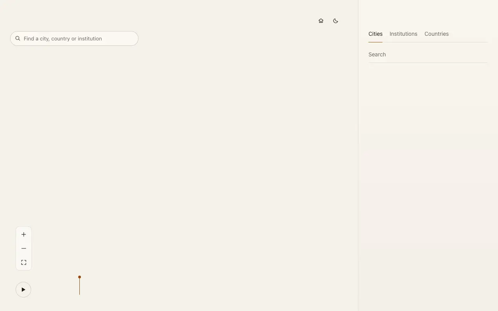
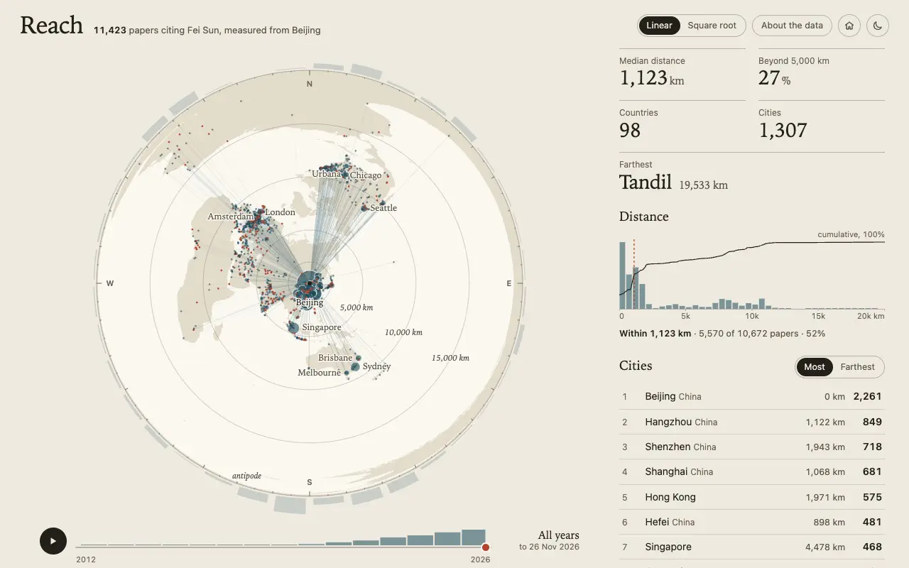
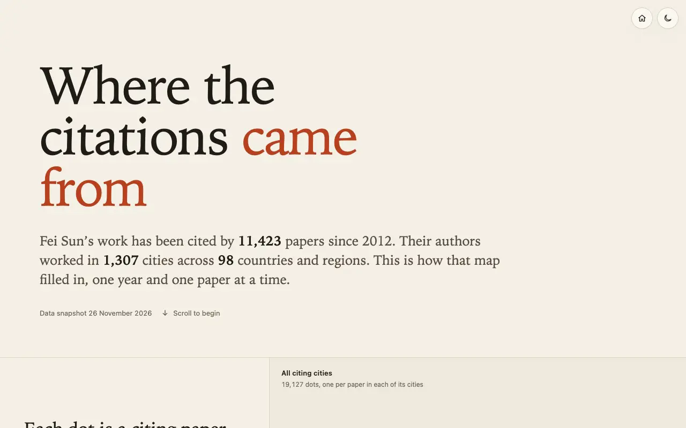
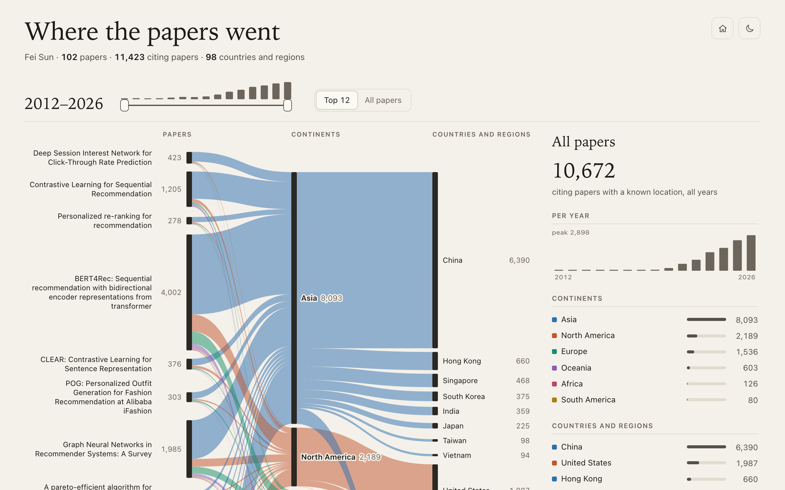
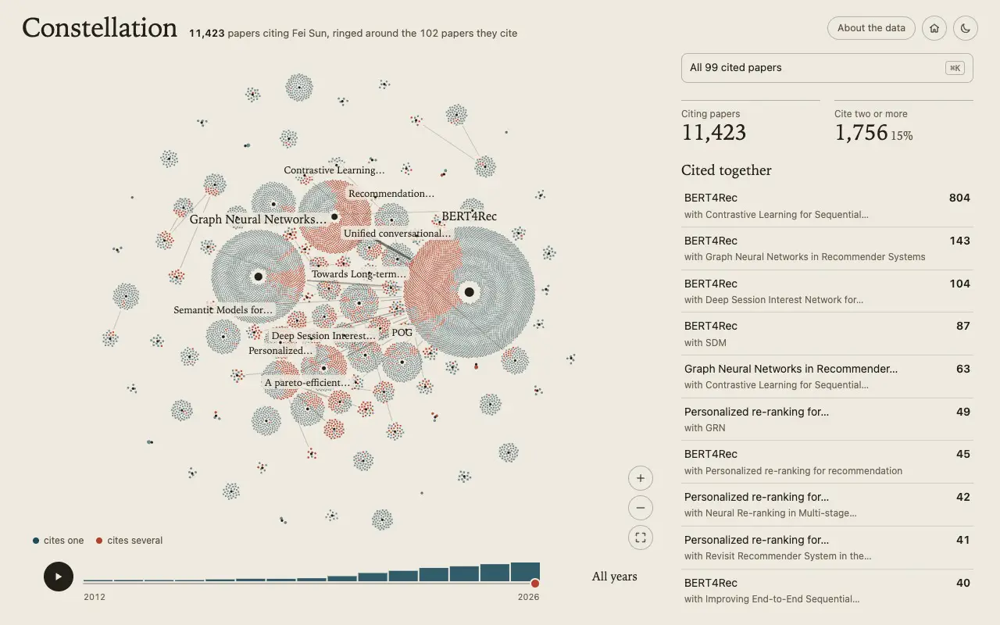
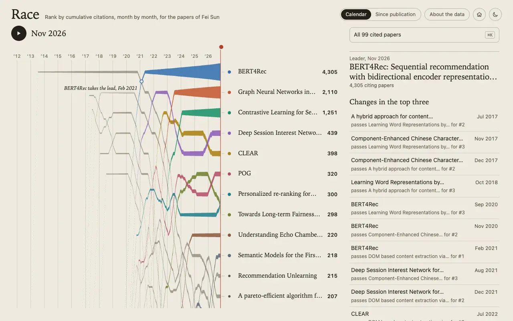
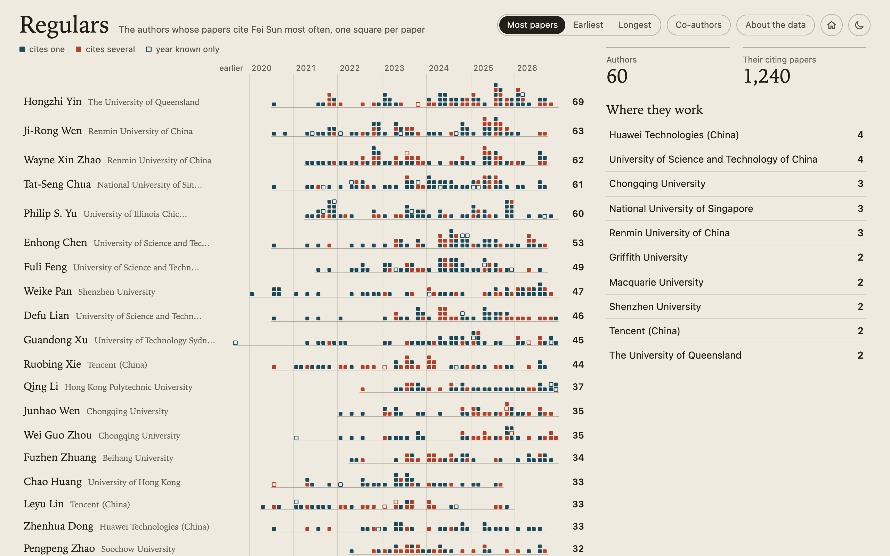
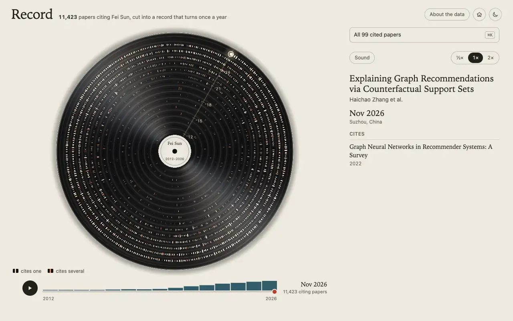

<h1 align="center">
  <picture>
    <source media="(prefers-color-scheme: dark)" srcset="docs/wordmark-dark.png">
    
  </picture>
</h1>

<p align="center">你的引用背后的故事：谁在读你的论文，在哪里读，从什么时候开始读。</p>

<p align="center">
  
  
  
  
</p>

<p align="center"><a href="#atlas在世界的哪里">Atlas</a> · <a href="#reach传得多远">Reach</a> · <a href="#story怎样传开">Story</a> · <a href="#flow从论文到地方">Flow</a> · <a href="#constellation论文和它的邻居">Constellation</a> · <a href="#race谁在什么时候领先">Race</a> · <a href="#regulars谁总是回来">Regulars</a> · <a href="#record听一听">Record</a></p>

<p align="center"><a href="README.md">English</a> | <b>简体中文</b></p>


给它一个 Google Scholar 主页，它会在
[OpenAlex](https://openalex.org) 里找出引用这个人的所有论文，把每篇论文放到作者所在机构的城市上，再据此生成八个交互页面。
下个月再运行一条命令，页面就是最新的。

- **一份数据，八种视图。** 两张地图、一篇长文、一张流向图、一张星图、一场排名赛、一张常客表，还有一张可以播放的唱片。
- **只需一个输入。** 一个 Scholar 链接就够了。自动判断出错时，有几个可选字段可以纠正。
- **静态输出。** 纯 HTML、CSS 和 JavaScript，不需要构建，也不依赖框架。直接从本地打开，或放到任何静态托管上都行。八个页面里有七个可以离线使用。
- **只用标准库。** 数据流程是 Python 3.9+，不需要安装任何包。

图中是我自己的主页（来自 1,307 个城市的 11,423 篇引用论文，快照日期 2026 年 11 月 26 日），使用浅色主题；每个页面也都有深色主题。动图是页面的真实录屏，做了加速。

## 目录

- [视图](#视图)
- [快速开始](#快速开始)
- [profile.json](#profilejson)
- [保持更新](#保持更新)
- [放到网站上](#放到网站上)
- [为什么用 OpenAlex，而不是 Google Scholar](#为什么用-openalex而不是-google-scholar)
- [数字是怎么来的](#数字是怎么来的)
- [目录结构](#目录结构)
- [致谢与灵感](#致谢与灵感)
- [由 AI 构建](#由-ai-构建)
- [许可证](#许可证)

## 视图

这些视图都从同一个问题出发：引用数只是一个数字，但每一次引用都是某个人、在某个地方、某个时刻写下的一篇论文。
把这些论文放回地图、放回时间里，引用数会是什么样子？

每个视图为什么采用现在的形式、试过又放弃了什么、Record 的声音如何设计，见 [DESIGN.zh-CN.md](DESIGN.zh-CN.md)。

### Atlas：在世界的哪里



一个地球仪，展开后变成可以缩放到街道级别的实时地图。每个产生过引用论文的城市是一个光点，
从主页主人所在机构沿大圆画一条弧线连到它。点击播放，引用按时间顺序依次出现，从第一篇一直到快照日期。
你可以单独选一篇论文，搜索任意城市、国家或机构，也可以在地球仪和平面地图之间切换。

光点亮度和弧线粗细按城市引用数的平方根计算，这样少数几个特别大的城市不会盖过那一长串只有一两篇的地方。
弧线表示的是联系，不是路线。

这是唯一需要联网的页面：它会加载 MapLibre GL JS 和 OpenFreeMap 的地图瓦片。

### Reach：传得多远



以一个点为中心重画世界。Reach 使用以主人所在城市为中心的方位等距投影：每个城市都在真实的距离和真实的方位上，
圆盘边缘就是对跖点，也就是地球上正对面的那个点。圆环标出 2,000、5,000、10,000 和 15,000 公里；一个开关可以用平方根比例把拥挤的中心拉开。
右侧的直方图回答"想法传了多远"：距离中位数、超过 5,000 公里的比例，以及最远的城市。

### Story：怎样传开



一篇滚动阅读的长文，每篇引用论文是一个 WebGL 圆点。圆点先聚在地图上各自的城市，然后离开地图，
依次变成每年引用数的柱子、按大洲的堆叠、按机构的行，最后回到地图上。

文字是根据数据算出来的，不是为某个人专门写的：
- 最早的引用什么时候来、从哪里来；
- 引用开始起飞的那一年（增长最陡之前的那一年）；
- 哪些论文传得最远；
- 家乡在整幅图里占多大比重；
- 哪些国家恰好只出现过一次。

数据撑不起来的章节会被略去，比如一份一开始就增长很快的记录，就不会有"沉寂的年份"这一章。

### Flow：从论文到地方



完全没有地图。色带从每篇论文流向引用它的大洲，再流向国家。色带宽度是把这篇论文和这个国家连起来的引用论文数；一篇有两个国家作者的论文，两边都会计入。
它回答地图不好回答的问题：哪篇论文主要在一个国家被读，哪篇传得很广。

### Constellation：论文和它的邻居



每篇被引论文是一颗星。引用它的论文是围绕它的一圈圈圆点，每年一圈，最早的在最里面。
圆点按黄金角排布，每个点占的面积相同，所以一圈越宽，说明那一年越热闹。

如果一篇引用论文同时引用了主人的好几篇论文，它会用强调色画出，并放在圆环朝向其他几颗星的一侧。
经常被一起引用的星彼此靠得更近，位置由确定性的力导向布局算出，关联最强的几对之间连有线。

### Race：谁在什么时候领先



按累计引用数排名，画成随时间延伸的色带。一条泳道是一个名次，色带宽度随引用数增长，两条色带交叉的地方，
就是一篇论文超过了另一篇。这是去掉了柱子的"柱状图赛跑"：完整的历史一直留在画面上，而不是一闪而过。
只有新的排名保持了六个月，才算一次超越并列出来。

第二个时钟"自发表起"让每篇论文从它自己的发表日期开始计时，这样 2012 年和 2022 年的论文可以在相同"年龄"下比较。

### Regulars：谁总是回来



引用这些工作最频繁的作者：每人一行，每篇引用论文一个方块，按季度堆叠。强调色的方块表示同时引用了主人多篇论文。
空心方块表示只知道年份、不知道具体日期的论文。合作者默认隐藏，一个开关就能显示。

这个页面列出的是别人的名字。它们来自公开的文献记录，但发布之前请记住这一点。

### Record：听一听



把引用历史刻成一张唱片，每年转一圈，每篇引用论文是唱片纹路里的一道刻痕。可以播放它，用手拖着转，
也可以把唱针拖过不同的年份。打开声音后，每篇被引论文对应 D 利底亚调式上一个固定的音，被引最多的几篇合起来是一个和弦。
一道刻痕会奏出它所引用的那些论文的音，同时经过唱针的刻痕合在一起响：热闹的年份听起来更饱满，而不是更快。

另外还有一个首页，链接到全部八个视图，并给出总数。

## 快速开始

你需要：
- Python 3.9 或更新版本，只用标准库；
- 网络连接，用于访问 OpenAlex 和 Google Scholar；
- 任意一个现代浏览器，用来查看结果。

```sh
git clone https://github.com/FeiSun/CiteStory.git citestory
cd citestory
mkdir -p profiles/me
cat > profiles/me/profile.json <<'EOF'
{ "scholar_url": "https://scholar.google.com/citations?user=XXXXXXXXXXXX" }
EOF
python3 code/citestory.py update profiles/me
open profiles/me/site/index.html        # macOS；其他系统用浏览器打开这个文件
```

第一次运行时，会为主页上的每篇论文发一次 OpenAlex 搜索，然后分页抓取引用论文（11,000 篇引用论文大约 60 次请求），
最后查询机构信息。大概需要几分钟。

**请先申请一个免费的 OpenAlex API key。** OpenAlex 给每个用户一份每日额度，在 UTC 零点重置：
没有 key 时是 0.10 美元，同一 IP 地址的所有人共用；有免费 key 时是 1 美元。每次标题搜索 0.001 美元，
每页结果 0.0001 美元。一个 100 篇论文、11,000 篇引用论文的主页，第一次运行约 0.12 美元：100 次搜索，
再加上引用论文和机构约 100 页。没有 key 时，大约 95 次搜索后当天额度就用完了，运行会停下，第二天再继续。
每月更新约 0.02 美元，因为只搜索新增的标题。有免费 key 时两者都远在每日额度之内，不需要付费。

在 [openalex.org/signup](https://openalex.org/signup) 注册账号，然后在
[Settings → API key](https://openalex.org/settings/api-key) 复制 key。工具从环境变量 `OPENALEX_API_KEY` 读取，
否则从仓库目录（包含 `code/` 的那个目录）下的 `.env` 文件读取，这个文件已被 git 忽略。
key 只作为请求头发送，不会写入磁盘，也不会出现在日志里。

```sh
echo 'OPENALEX_API_KEY=...' > .env      # 或者：export OPENALEX_API_KEY=...
```

Google Scholar 没有 API。这个工具像浏览器一样读取公开的主页：每 100 篇论文一次请求，请求之间有停顿。
如果 Google 返回验证码，运行会停下并提示。这时请在浏览器里打开主页，一直点"显示更多"直到按钮变灰，
把网页另存下来，然后让 `scholar_html` 指向这个文件。请妥善保管这个文件：登录状态下保存的网页里包含你的账号邮箱。

`profiles/example/` 里的示例列出了所有字段。

## profile.json

```json
{
  "scholar_url": "https://scholar.google.com/citations?user=XXXXXXXXXXXX",
  "scholar_html": "scholar.html",
  "aliases": ["张三", "S. Zhang"],
  "home": "I4210090176",
  "deploy_to": "~/sites/my-al-folio/assets/citations"
}
```

只有 `scholar_url`（或 `scholar_html`）是必填的。

| 字段 | 用途 |
|---|---|
| `scholar_url` | 公开的 Google Scholar 主页 |
| `scholar_html` | 主页网页的本地副本，在 Google 拒绝访问链接时使用 |
| `name` | 主人的名字，如果和 Scholar 主页上的不同 |
| `aliases` | 署名里出现的其他写法：另一种文字的名字、曾用名、"J. Smith" 这类缩写 |
| `openalex_author_ids` | 属于主人的 OpenAlex 作者 id，用于署名太特殊、无法自动匹配的情况 |
| `home` | 主人所在机构的 OpenAlex id，在自动判断出错或缺失时使用（[在这里搜索](https://openalex.org)） |
| `deploy_to` | 每次构建后，把生成的页面复制到这个文件夹 |

## 保持更新

```sh
python3 code/citestory.py update profiles/me     # 抓取新快照，然后重新构建
python3 code/citestory.py build  profiles/me     # 只重新构建，比如修改模板之后
```

每次 `update` 会重新读取 Scholar 论文列表，只匹配之前没见过的标题，重新下载所有引用论文，然后重新构建。
新快照只有在完整时才会替换旧快照。如果运行中途停下（速率限制、网络问题、请求额度用完），
网站会用上一份快照重新构建，命令以状态码 2 退出，下次运行会从停下的地方继续。`--restart` 会丢弃未完成的刷新。

快照保存在 `profiles/me/data/`：`targets.json`（你的论文及其匹配结果）、`citing.json`、`institutions.json`
和 `manifest.json`。`name`、`aliases`、`openalex_author_ids` 和 `home` 在 `update` 时生效，`build` 不会读取它们。
没匹配上的标题每次 `update` 都会重新搜索，所以新加的别名马上生效；已经匹配过的标题会沿用原来的结果。如果想去掉一个错误的匹配，删掉 `data/targets.json` 再运行 `update`，它会重新搜索所有标题。

想每月自动刷新，一行 crontab 就够了：

```cron
0 6 1 * *  cd /path/to/citestory && python3 code/citestory.py update profiles/me >> update.log 2>&1
```

## 放到网站上

`profiles/<name>/site/` 里是页面需要的全部文件，没有多余的东西：九个 HTML 文件和四个数据文件。
把这个文件夹复制到任何静态托管上即可，或者设置 `deploy_to`，让它自动复制。

**外观沿用了 [al-folio](https://github.com/alshedivat/al-folio)**，也就是我个人主页用的 Jekyll 主题：
- 衬线标题，安静的配色；
- 浅色/深色主题存在同一个 `localStorage` 键（`theme`）下，所以切换网站主题时，这些页面也会跟着切换；
- 嵌入模式 `atlas.html?embed` 会去掉页面自带的外框，使用网站的背景色，并把自己的高度告诉宿主页面，让 iframe 能自适应高度。

`al-folio/` 里有一个项目页面，以及这种配置的分步说明。

如果你的网站风格不同，可能需要调整设计。共用的颜色、字体和外框在 `code/templates/_shell.html` 和每个模板的开头。
修改后运行一次 `build`。

## 为什么用 OpenAlex，而不是 Google Scholar

Google Scholar 只用来提供你的论文列表。所有引用论文、作者、机构和地点都来自 OpenAlex。

Google Scholar 的引用数更高，但它没有 API。要从 Scholar 收集引用论文，只能一页一页地打开"被引用次数"页面，
每页 10 篇，一万次引用就要打开大约 1,000 页。Google 很快就会用验证码拦住这种访问，所以一次运行很少能跑完，更没法每个月自动重跑。
而且这些页面不提供引用作者的机构和所在地，而地图恰恰需要这两样。

OpenAlex 是一个开放的学术文献目录，有文档完整的 API，数据采用 CC0 协议。一次查询最多返回 200 篇引用论文，
每篇都带着作者、作者的机构，以及机构的坐标。完整跑一次只要几分钟，也可以无人值守地定期重跑。

代价是覆盖面。OpenAlex 找到的引用比 Google Scholar 少，因为 Scholar 还会统计学位论文、幻灯片、课程网页等
OpenAlex 不收录的文档。差距大约在 15%；很新的论文，以及不主要发表在期刊和会议上的领域，差距会更大。

页面的计数方式也不一样。Google Scholar 里，一篇引用论文引用了你几篇论文，就算几次；页面上的总数里每篇引用论文只算一次（[原因](#数字是怎么来的)）。
以我自己的主页为例：

| | 数量 |
|---|---|
| Google Scholar 主页，全部 108 篇论文 | 16,095 次引用 |
| Google Scholar，在 OpenAlex 里匹配上的 102 篇 | 16,032 次引用 |
| OpenAlex，同样的 102 篇，按 Scholar 的方式计数 | 13,625 次引用（少 15%） |
| OpenAlex，每篇引用论文只算一次：页面上的数字 | 11,423 篇引用论文 |

如果要和 Scholar 对比，请比较分布（在哪里、在什么时候），而不是总数。

即使是论文列表，每次运行也只从 Google Scholar 读一次，每 100 篇论文一个页面。如果 Google 拒绝访问，
用另存下来的主页文件也一样可以（见[快速开始](#快速开始)）。

## 数字是怎么来的

- **匹配论文。** 每个 Scholar 标题都会在 OpenAlex 里搜索。只有规范化后的标题一致、且署名中包含主人，结果才会被接受。
  名字可以是姓在前或姓在后，可以省略中间名，名可以只写首字母，也可以是 `aliases` 里的任意一种写法。
  所有匹配上的版本（预印本、会议版、期刊版）都会保留，并在页面上按标题合并。没有找到的标题会在数据里列出。
- **引用论文。** 即参考文献列表里包含任意一篇已匹配论文的 OpenAlex 文献，通过 `cites:` 过滤器收集并去重。
  OpenAlex 的覆盖范围比 Google Scholar 窄，所以总数会低于主页上的引用数（[原因](#为什么用-openalex而不是-google-scholar)）。
- **计数。** 各种总数里，每篇引用论文只算一次，即使它引用了主人的好几篇论文：引用论文总数，以及按城市、国家、大洲、
  年份和作者的计数都是这样。这些页面关心的是谁在读、在哪里读。一篇引用了主人三篇论文的文章，仍然只是一组作者写的一篇论文，
  算成三次会让它所在的城市显得热闹三倍。文献数据库也把这两个数分开：Web of Science 有 "Times Cited" 和 "Citing Articles"，
  Scopus 有 "citations" 和 "citing documents"。Google Scholar 主页上的总数是另一种，即各篇论文被引数之和。
  当问题落在某一篇论文上时（Flow 里论文的数字、Race 的排名、Constellation 里每颗星的光环、论文选择器里的数字），
  一篇引用论文引用了几篇就算几次，和 Google Scholar 一样，所以这些数字可以逐篇和 Scholar 对比。
  Constellation、Regulars 和 Record 会用强调色标出同时引用多篇的论文。
- **地点。** 一篇引用论文会被放到其作者所在机构的各个城市上，每个城市只计一次。国家和大洲的总数也是每个国家或大洲只计一次。
  机构坐标通常是总部所在地。没有机构信息的论文会计入总数，但无法放到地图上，页面会说明有多少篇。自引也包含在内。
- **合并地点。** OpenAlex 有时会给同一个地方两个 id，或者用区名代替城市名。同一国家内、25 公里以内同名的两个地点会合并；
  如果较小的地点位于一个论文数是它十倍的地点 8 公里以内，也会合并。规模相近的邻近城镇保持分开。
- **家乡。** 主人最近三年里最常出现的机构，除非 `home` 另有指定。
- **日期。** OpenAlex 只知道年份时会写成 1 月 1 日。这些论文会按其 id 的稳定哈希分散到当年各个时间，
  这样动画不会每到一月就跳一下。展示单篇论文的页面会把它们标为"仅知年份"。

`code/DATA.md` 逐字段说明了页面读取的数据文件。

## 目录结构

```
code/
  citestory.py           命令入口：update 或 build
  fetch_citation_geo.py  Scholar 列表、OpenAlex 匹配、引用论文、机构
  build_citation_geo.py  汇总城市，写出 data.js，填充模板
  build_views.py         论文、共引布局、作者：views.js
  templates/             八个页面和首页；_shell.html 和 _picker.html 是共用部分
  basemap/               Natural Earth 1:50m 国家边界
  test_*.py              单元测试：python3 -m unittest discover -s code -p "test_*.py"
  DATA.md                数据约定
DESIGN.zh-CN.md          各个视图为什么是现在这样
profiles/
  example/profile.json   可以复制的示例配置
  <name>/                你自己的：profile.json、data/（快照）、site/（页面）；已被 git 忽略
al-folio/                al-folio 网站的项目页面和说明
docs/screenshots/        本 README 中的图片（动态 WebP 和 PNG）
```

## 致谢与灵感

**数据和库**
- [OpenAlex](https://openalex.org)：文献、作者和机构数据（CC0）。
- [Google Scholar](https://scholar.google.com)：论文列表。
- [Natural Earth](https://www.naturalearthdata.com)：国家边界（公有领域），已随项目附带。
- [MapLibre GL JS](https://maplibre.org) 5.24.0（BSD-3-Clause），由 Atlas 从 unpkg 加载，并用完整性哈希锁定版本。
- [OpenFreeMap](https://openfreemap.org) 地图瓦片，基于 [OpenMapTiles](https://openmaptiles.org) 和
  [OpenStreetMap](https://www.openstreetmap.org/copyright) 数据。

**借鉴的想法。** Atlas 借鉴了一些想法，但没有借用代码：GitHub 和 Stripe 首页上的地球仪，
[Shipmap.org](https://www.shipmap.org)（深色世界地图上的动态轨迹），以及 [Flowmap.blue](https://flowmap.blue)（按流量加权、画在地点之间的流线）。

**直接使用的标准形式**，列出名字方便你查阅：
- 方位等距投影（Reach）；
- Šavrič、Patterson 和 Jenny 于 2018 年提出的 Equal Earth 投影（Story）；
- 滚动叙事（Story）；
- 桑基图（Flow）；
- 黄金角（叶序）圆点排布（Story、Constellation）；
- 凹凸图，作为对柱状图赛跑的回应（Race）；
- 单位图（Regulars）。

据我所知，Constellation 的圆环和 Record 是我自己的想法。如果你之前见过类似的设计，请告诉我，我会补上致谢。

## 由 AI 构建

CiteStory 几乎完全由 AI 构建。我不做前端开发，真正关键的那些代码我也没读多少。
[Claude Code](https://claude.com/claude-code) 写了代码、做了测试和审查，其他 AI 工具偶尔也帮了些忙。
我负责的是最初的那点念头、想法、设计，以及无数轮"不对，还差一点"。对一个讲"被阅读"的项目来说，这样似乎正合适。
所以代码的功劳主要归 Claude Code；设计和想法，连同其中的毛病，都是我的。

这对你意味着：

* **没有任何保证。** 它在我的 Mac 上、用我自己的主页能正常工作，也有不少测试，但没有人审计过。使用风险自负。
* **引用数字之前请先核对。** 数据来自 OpenAlex，不是 Google Scholar，而匹配论文、人和地点都用到了启发式方法。上面的说明写清楚了是哪些地方。
* **欢迎提 issue 和想法。** 回复可能会慢，也可能来自 Claude。

## 许可证

[MIT](LICENSE)。附带的 Natural Earth 数据属于公有领域。从 OpenAlex 获取的数据为 CC0。
